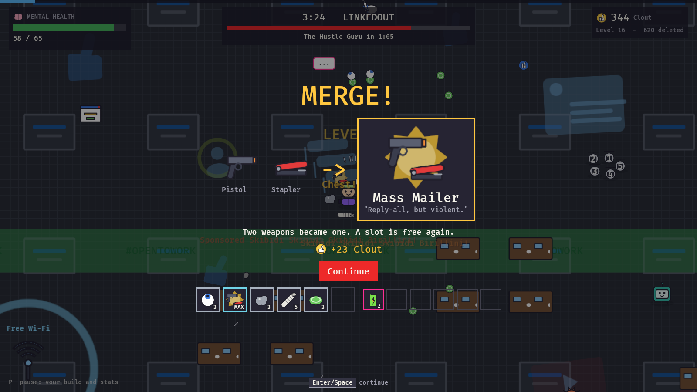

# AI Slop Arena

A survivor-like about one ordinary human against an endless feed of AI slop that trains on
how you play. You move; your weapons fire on their own. Mental Health is your HP.

Version 3 turned the 20-wave game with a shop into one endless run: see the
[version 3 design](docs/design-v3.md). The original design document is
[here](https://claude.ai/artifact/HArLkFquUixzNAmQXpZDuZ).




## The game

- **One endless run on an endless map.** You scroll through the Feed: all six parody
  platforms in a shuffled order (FaceSlop, LinkedOut, MeTube, Thredd, InstaSlop,
  ClockTok), each with its floor, hazard and local slop. About 4:30 into a platform its
  boss arrives; delete it and the Feed moves on. After the sixth boss comes The Model.
  After The Model the Feed keeps going, and so does the slop, until you burn out.
- **Level up, pick one of three.** Likes are experience. Every choice on offer is valid:
  new weapons (six slots), weapon levels 1 to 8, items with levels (six slots), stat-ups.
- **Merges.** Two weapons that belong together, both at level 8, merge into one stronger
  weapon when you open a chest: Rock + Slingshot = Meteor Shower, Eye-Roll + Uno Reverse =
  Infinite Uno, Frisbee + Dog Walk = Dog Park, and ten more. The merge frees a slot.
- **29 weapons and 13 merged ones** in four damage types that each do something: Analog
  staggers, Fact cuts through shields, Sarcasm confuses, Grass roots. Carry two of a type
  for a set bonus, four for a stronger effect.
- **Elites** with affixes (Verified, Viral, Sponsored, Trending, Toxic) drop chests.
- **The map:**
  - walls and maintenance fences
  - downvote zones in every shape
  - ads and crypto miners to smash
  - Wi-Fi hotspots that heal
  - vending and gacha machines that want your Clout
  - shrines with blessings
  - data centers to hold while they upload
  - comment sections full of elites
- **Pickups:** Touch Grass (heal), Algorithm Boost (magnet), Mass Report (clear the
  screen), Server Outage (freeze), Clout, chests.
- **The slop learns.** Every two minutes it retrains on what killed it (zero-sum
  resistances) and the brainrot that hurt you breeds: ten bodies, ten objects, ten
  accessories, each with an ability and a fake-Italian name.
- Every sprite, icon and sound is generated in code; the game ships no asset files.

## Play

```bash
cargo run --release -p slop_game
```

| Keyboard | Gamepad (Xbox) | Action |
| --- | --- | --- |
| WASD or arrows | Left stick or d-pad | Move; on screens, move the highlight |
| Enter or E | A | Press the highlighted card or button |
| Space | A, Start | Continue |
| P or Esc | Start | Pause: your build, blessings and stats |
| Esc | B | Back; walk away from a machine |
| R | Y | Reroll a level-up (one free, then Clout) |
| 1-4 | | Pick a level-up card |
| Alt+Enter or F11 | | Fullscreen or a window |
| F12 | | Screenshot to `Pictures\AI Slop Arena` |

Stand in a machine's ring to use it; walk into ads and miners to break them. Everything
also works with the mouse. The game starts fullscreen.

## Tools

```bash
cargo run --release -p slop_game -- --autoplay --screenshots shots --exit-on-end
cargo run --release -p slop_lab -- bench
cargo run --release -p slop_lab -- determinism
cargo run --release -p slop_lab -- balance 16 40
cargo run --release -p slop_lab -- progress 6
sh tools/check.sh
```

- `--autoplay` lets the bots play the Feed and saves a screenshot of every kind of screen;
  `--seed N` picks the run, `--speed N` the fast-forward, `--windowed` and `--size WxH`
  the window.
- `slop_lab balance` plays whole runs with a heuristic and a random bot and prints minutes
  survived, bosses beaten and the weapons they ended with.
- `slop_lab progress` prints level, kills, slop on the field, health and Clout minute by
  minute.
- `tools/check.sh` runs clippy and every test, and regenerates the traceability table.

## Layout

| Crate | What it is |
| --- | --- |
| `slop_sim` | The deterministic simulation and the endless map. No engine code. |
| `slop_rules` | The run: the director, level-ups, chests and merges, items, machines, heroes and training. |
| `slop_lab` | Headless tools: benchmark, determinism check, balance runs. |
| `slop_game` | The Bevy client: rendering, input (keyboard and gamepad), HUD, screens, generated art and sound. |

## Docs

- [Version 3 design](docs/design-v3.md)
- [Requirements](docs/requirements.md)
- [Architecture](docs/architecture.md)
- [Verification](docs/verification.md)
- [Traceability](docs/traceability.md)
