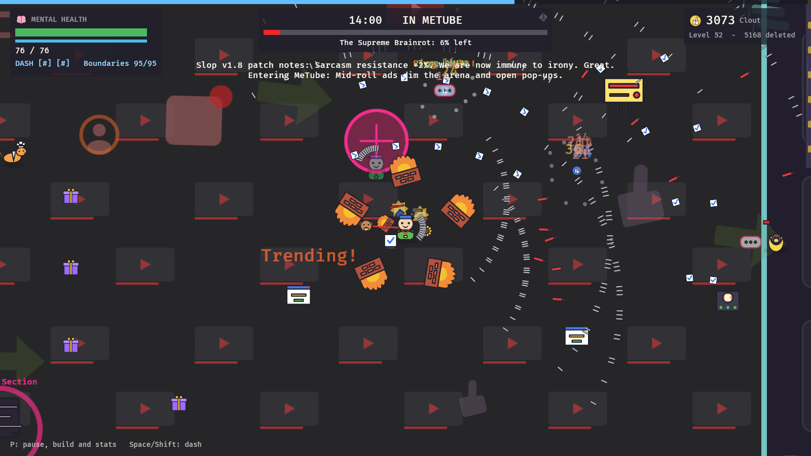
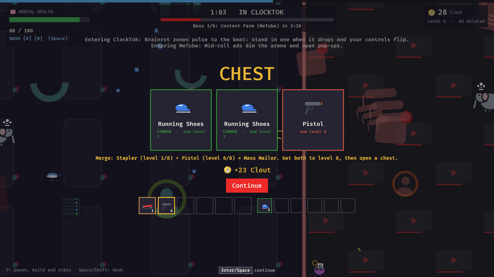
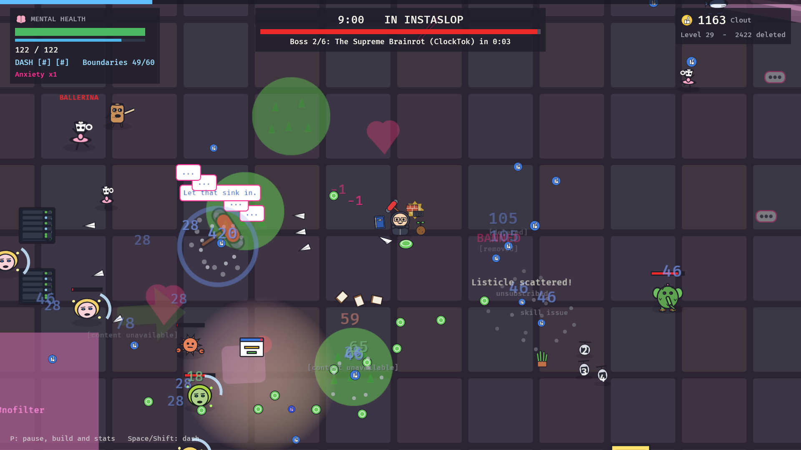
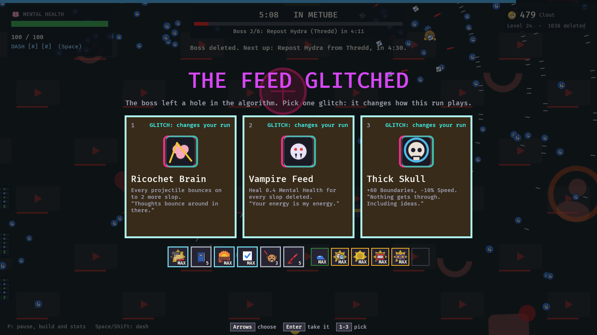

# AI Slop Arena

A survivor-like about one ordinary human against an endless feed of AI slop that trains on
how you play. You move and dash; your weapons fire on their own. Mental Health is your HP.

Version 3 turned the 20-wave game with a shop into one endless run
([version 3 design](docs/design-v3.md)). Version 4, "The Algorithm Update", adds dashes,
defence, rare loot, glitches, rule-bending heroes, biomes, events and the brainrot icons
([version 4 design](docs/design-v4.md)). The original design document is
[here](https://claude.ai/artifact/HArLkFquUixzNAmQXpZDuZ).









## The game

- **One endless run on an endless map.** The map is a patchwork of the six parody
  platforms (FaceSlop, LinkedOut, MeTube, Thredd, InstaSlop, ClockTok): walk into a square
  and its floor, slop and hazard take over. Bosses come in order, about 4:30 apart; after
  the sixth comes The Model, and then the Feed keeps going until you burn out.
- **Dash.** Two charges that come back in 3 s; untouchable while dashing. Items make
  dashes hit, burn, shock, or come back faster.
- **Level up, pick one of three.** Every choice is valid: new weapons (six slots), weapon
  levels 1 to 8, items with levels (six slots), stat-ups, and now and then a glitch.
- **Rarities and legendaries.** Common, rare, epic and legendary items. Legendaries break
  the rules: two more projectiles on every weapon, exploding kills, a second you.
- **Chests** spin like slot machines and hold one, three or five upgrades. Golden chests
  hold a legendary. Two weapons that belong together, both at level 8, merge when you open
  a chest: 15 recipes, such as Rock + Slingshot = Meteor Shower.
- **Glitches.** Every boss leaves a pick of three perks that change the run: Echo Chamber,
  Ricochet Brain, Cursed Feed, Glass Cannon...
- **Eight heroes** that bend the rules (the Boomer never gets Sarcasm weapons; the
  Influencer's Clout is damage); the hero screen lists every property.
- **33 weapons and 15 merged ones** in four damage types that each do something, and
  barriers (Firewall, Bubble Wrap) that stop enemy shots.
- **Twelve stats**, including Boundaries (a shield that comes back) and Hustle (Clout every
  minute, more coins).
- **Events:** swarms cross the screen, pop-up walls close in, livestreams lock you in a
  ring with the crowd for a big chest.
- **The brainrot icons:** Tonk Tonk Tonk Sahur, Tralalelo Sneakerlala, Bombardilo
  Crocodilo, Lirilì Larilò and eight more parodies, animated, each with a trick.
- **The map:** walls, maintenance fences, downvote zones in every shape, ads to smash,
  Wi-Fi, vending and gacha machines, shrines, data centers, comment sections, Go Live
  ring lights.
- **The slop learns.** Every two minutes it retrains on what killed it, and the brainrot
  that hurt you breeds.
- Every sprite, icon and sound is generated in code; the game ships no asset files.

## Play

```bash
cargo run --release -p slop_game
```

| Keyboard | Gamepad (Xbox) | Action |
| --- | --- | --- |
| WASD or arrows | Left stick or d-pad | Move; on screens, move the highlight |
| Space or Shift | A, RB, RT | Dash (while playing) |
| Enter or E | A | Press the highlighted card or button |
| Space | A | Continue |
| P or Esc | Start | Pause: your build, glitches and stats |
| Esc | B | Back; resume; walk away from a machine |
| R | Y | Reroll a level-up (one free, then Clout) |
| 1-8 | | Pick a card |
| Alt+Enter or F11 | | Fullscreen or a window |
| F12 or Print Screen | | Screenshot to `Pictures\AI Slop Arena` |

Stand in a machine's ring to use it; walk into ads and miners to break them. Everything
also works with the mouse. The game starts fullscreen.

## Tools

```bash
cargo run --release -p slop_game -- --autoplay --screenshots shots --exit-on-end
cargo run --release -p slop_lab -- bench
cargo run --release -p slop_lab -- determinism
cargo run --release -p slop_lab -- balance 16 40
cargo run --release -p slop_lab -- progress 6
sh tools/check.sh
```

- `--autoplay` lets the bots play the Feed and saves a screenshot of every kind of screen;
  `--seed N` picks the run, `--speed N` the fast-forward, `--windowed` and `--size WxH`
  the window.
- `slop_lab balance` plays whole runs with a heuristic and a random bot and prints minutes
  survived, bosses beaten and the weapons they ended with.
- `slop_lab progress` prints level, kills, slop on the field, health and Clout minute by
  minute.
- `tools/check.sh` runs clippy and every test, and regenerates the traceability table.

## Layout

| Crate | What it is |
| --- | --- |
| `slop_sim` | The deterministic simulation and the endless map. No engine code. |
| `slop_rules` | The run: the director and its events, level-ups, chests, glitches, items, machines, heroes and training. |
| `slop_lab` | Headless tools: benchmark, determinism check, balance runs. |
| `slop_game` | The Bevy client: rendering, input (keyboard and gamepad), HUD, screens, generated art and sound. |

## Docs

- [Version 4 design](docs/design-v4.md)
- [Version 3 design](docs/design-v3.md)
- [Requirements](docs/requirements.md)
- [Architecture](docs/architecture.md)
- [Verification](docs/verification.md)
- [Traceability](docs/traceability.md)
