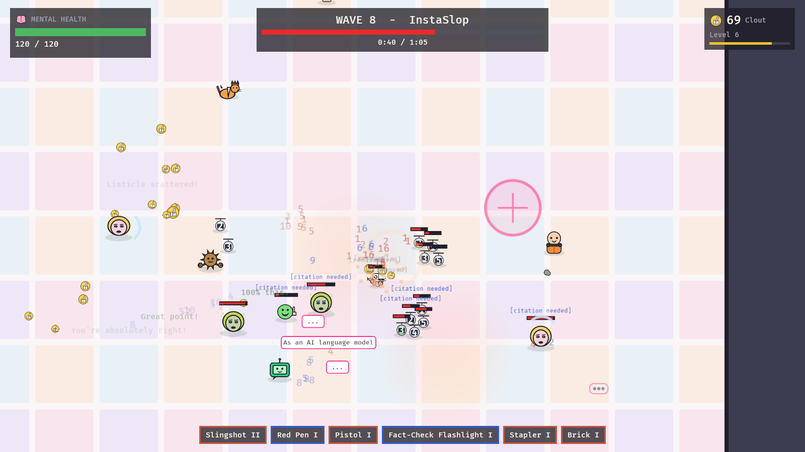

# AI Slop Arena

A roguelike bullet heaven about one ordinary human against twenty waves of AI slop that
trains on how you play. You move; your weapons fire on their own. Mental Health is your HP.

The design and the implementation plan live in the
[design document](https://claude.ai/artifact/HArLkFquUixzNAmQXpZDuZ).



## The game

- **20 waves, about 40 minutes.** After every wave you level up, read the slop's patch
  notes, and shop. Waves 10 and 20 are boss waves. One Burnout ends the run.
- **Five heroes** with their own starting weapon, item and quirk: Boomer, Zoomer, Teacher,
  Programmer, Artist. Everything is unlocked; there is no meta progression.
- **22 weapons** in four damage types: Analog, Fact, Sarcasm and Grass. Buying a weapon you
  own upgrades it, up to tier IV; you have six slots.
- **32 items**: healthy habits, risky habits with drawbacks, side hustles that pay Clout, and
  actives that fire on their own.
- **The slop:** parody chatbots (ChadGPT, Clawed, Yes-Bot, Hallucinator, Listicle Drones),
  platform slop, and generated brainrot built from a body, an object and an accessory, with a
  fake-Italian name.
- **Six platforms**, one per run, each with its own floor, slop, hazard and wave-10 boss:
  FaceSlop, LinkedOut, MeTube, Thredd, InstaSlop, ClockTok. Wave 20 is always The Model.
- **Training runs.** After every wave the slop resists the damage types you kill with, and
  the brainrot that hurt you breeds. Resistances are zero-sum, so countering you always opens
  a weakness. A varied build makes The Model collapse.
- Every sprite and sound is generated in code; the game ships no asset files.

## Play

```bash
cargo run --release -p slop_game
```

| Key | Action |
| --- | --- |
| WASD or arrows | Move |
| P or Esc | Pause |
| Number keys | Pick a hero (1-5), a level-up (1-4), or buy a shop offer (1-6) |
| R | Reroll the shop |
| Space | Continue: start, close patch notes, start the next wave |
| Q | Quit (from menus, the end screen or pause) |

Everything also works with the mouse. The window can be resized; the game scales with it.

## Tools

```bash
cargo run --release -p slop_game -- --autoplay --screenshots shots --exit-on-end
cargo run --release -p slop_lab -- bench
cargo run --release -p slop_lab -- determinism
cargo run --release -p slop_lab -- balance 60
sh tools/check.sh
```

- `--autoplay` lets the bots play a whole run and saves a screenshot of every kind of
  screen; `--seed N` picks the run and `--speed N` the fast-forward.
- `slop_lab balance` plays whole runs with a heuristic and a random bot and prints win
  rates by hero, platform and boss.
- `tools/check.sh` runs clippy and every test, and regenerates the traceability table.

## Layout

| Crate | What it is |
| --- | --- |
| `slop_sim` | The deterministic wave simulation. No engine code. |
| `slop_rules` | The run: waves, shop, items, heroes, levels and training. |
| `slop_lab` | Headless tools: benchmark, determinism check, balance runs. |
| `slop_game` | The Bevy client: rendering, input, HUD, screens, generated art and sound. |

## Docs

- [Requirements](docs/requirements.md)
- [Architecture](docs/architecture.md)
- [Verification](docs/verification.md)
- [Traceability](docs/traceability.md)
